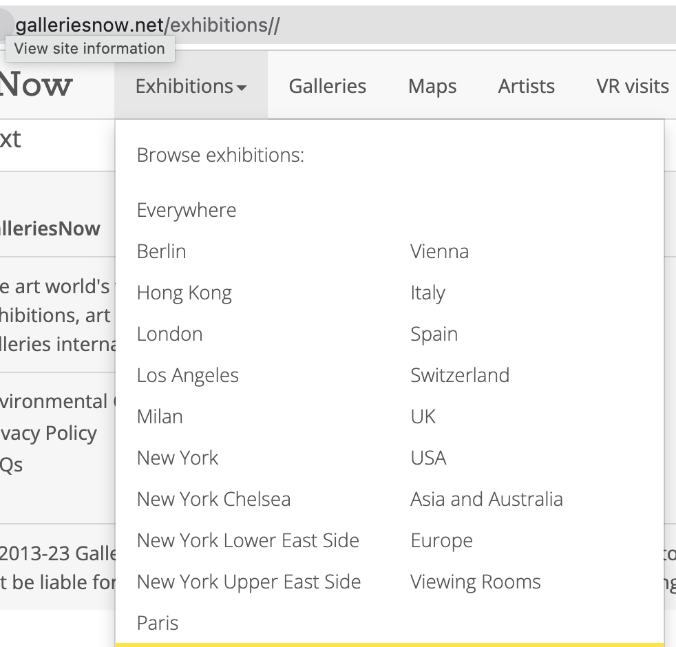

# wikiart_data_scraper

## Setup

Build docker image:
```shell
make build
```

Install Python dependencies (for local runs without Docker):
```shell
pip install -r requirements.txt
```

---

## `make run-dev` — Scrape wikiart.org (local)

Runs the full wikidata scraping pipeline locally without Docker.

```shell
make run-dev
```

**Environment params (set automatically by the target):**

| Variable | Value |
|---|---|
| `CONFIG_PATH` | `src/config.yml` |
| `PYTHONPATH` | `src/` |
| `ROOT_DATA_DIR` | `data/` |

**Pipeline steps (in order):**

1. **Collect artist pages** — scrapes artist listing pages from wikiart.org alphabet index
2. **Collect artist info** — scrapes each artist's detail page (bio, nationality, movement, etc.)
3. **Collect artwork URLs** — scrapes artwork image URLs per artist
4. **Merge dataset** — joins artist info with artwork URLs into combined output files
5. **Extract artwork descriptions** — parses cached HTML from `data/artworks_raw_html/` into structured JSON files written to `data/artworks_json/`; uses 2 parallel worker processes; skips files already present in `data/artworks_json/`
6. **Build descriptive stats** — computes quality stats over `data/artworks_json/` and writes `data/artworks_json_descriptive_stats.json`

**Inputs:**

| Source | Description |
|---|---|
| wikiart.org (live) | Artist listing pages, artist detail pages, artwork pages |
| `data/artworks_raw_html/*.html` | Cached artwork HTML pages (written by step 3, read by step 5) |

**Outputs:**

| File | Description |
|---|---|
| `data/06_artists_pages.csv` | List of all artists with their wikiart URLs |
| `data/06_artists_info.csv` | Artist metadata (nationality, movement, field, bio image, etc.) |
| `data/06_artists_wiki_texts.csv` | Wikipedia article text per artist |
| `data/06_artists_artworks.jsonl` | Artwork image URLs per artist |
| `data/06_content_db.csv.gz` | Full merged content dataset (artists + artworks) |
| `data/06_tags_db.csv.gz` | Art movement / style tag vocabulary |
| `data/artworks_raw_html/*.html` | Raw cached HTML pages per artwork |
| `data/artworks_json/*.json` | Structured artwork descriptors (see schema below) |
| `data/artworks_json_descriptive_stats.json` | Data quality stats |

**Artwork JSON schema** (`data/artworks_json/<artist-slug>_<artwork-slug>.json`):

```json
{
    "title": "Portrait of Lorenzo Lenzi",
    "artist": "Agnolo Bronzino",
    "date": "c.1528",
    "style": "Mannerism (Late Renaissance)",
    "genre": "portrait",
    "location": {
        "venue": "Sforza Castle",
        "city": "Milan",
        "country": "Italy"
    },
    "image": "https://uploads7.wikiart.org/.../unnamed.jpg!Large.jpg",
    "images": [
        "https://uploads7.wikiart.org/.../unnamed.jpg!Large.jpg",
        "https://uploads3.wikiart.org/.../portrait-of-lorenzo-lenzi.jpg!Large.jpg"
    ]
}
```

---

## `make analysis` — Compute artwork dataset quality stats (local)

Scans `data/artworks_json/` and writes a stats report without re-running the full scrape.

```shell
make analysis
```

**Inputs:**

| File | Description |
|---|---|
| `data/artworks_json/*.json` | Structured artwork JSON files produced by `make run-dev` |

**Output:**

`data/artworks_json_descriptive_stats.json`

```json
{
    "total_json_files": 12000,
    "json_with_any_empty_description": 4300,
    "share_json_with_any_empty_description": 0.358333,
    "json_with_empty_location": 3800,
    "share_json_with_empty_location": 0.316667,
    "empty_field_counts": {
        "title": 0,
        "artist": 0,
        "date": 1200,
        "style": 500,
        "genre": 300,
        "location_venue": 3800,
        "location_city": 3800,
        "location_country": 3800
    },
    "invalid_json_files": 0,
    "genre": {
        "portrait": 1842,
        "landscape": 1203
    },
    "style": {
        "Impressionism": 2341,
        "Romanticism": 987
    }
}
```

**Stats fields:**

| Field | Description |
|---|---|
| `total_json_files` | Total number of `.json` files scanned |
| `json_with_any_empty_description` | Count of files with at least one empty field |
| `share_json_with_any_empty_description` | Fraction of files with any empty field |
| `json_with_empty_location` | Count of files where venue, city and country are all empty |
| `share_json_with_empty_location` | Fraction of files with fully empty location |
| `empty_field_counts` | Per-field count of empty values |
| `invalid_json_files` | Count of files that could not be parsed |
| `genre` | Top-20 genres by artwork count (descending) |
| `style` | Top-20 styles by artwork count (descending) |

---

## `make run` — Start API + Streamlit app

Stops any running API, starts the FastAPI backend (detached), then launches the Streamlit UI in the foreground.

```shell
make run
```

- API: `http://localhost:8090` (log: `/tmp/art_scraper_api.log`)
- Streamlit: `http://localhost:8501`

To manage the API separately:

```shell
make run-api    # start API in foreground
make stop-api   # stop detached API process
make run-app    # start Streamlit in foreground
```

---

## Other targets

```shell
make build-search-index   # build search index inside Docker
make run-jupyter          # start Jupyter notebook server
```

---

## Scrape galleries

Find a link to a city:



Update `src/config.yml` with selected links, then run:

```shell
PIPELINE=galleries make run
```

---

## Work in progress

Refactor code with [multiprocessing](https://www.zenrows.com/blog/speed-up-web-scraping-with-concurrency-in-python#concurrency)

New data source: Artsy. Selenium needed =/

[italy](https://www.artsy.net/galleries?location=milan-italy) - automatically tap show_more

# Recommendation algorithm

TF-IDF based content recommendations. Artist tags (movement + field) are vectorized with `TfidfVectorizer`, splitting on `|` delimiter. Movement tags receive a 3× boost via repetition to weight them higher than field tags. Recommendations use cosine similarity between user preference vector and artist corpus.

---

## Image Classification (Fine-tuning)

Multi-class art genre classification using a fine-tuned Vision Transformer (`google/vit-base-patch16-224`).

| | |
|---|---|
| **Classes** | Impressionism, Surrealism, Minimalism, Pop Art |
| **Dataset** | 4 × 400 images (80/10/10 train/val/test split) |
| **Hardware** | 1× L40S GPU (48 GB VRAM), Nebius AI Jobs |
| **Best val accuracy** | 76% |

### Data pipeline

```
make run-dev          # scrape wikiart → data/artworks_json/*.json
make prepare-images   # download images → data/dataset/<style>/
                      # prepare splits → data/hf_dataset/{train,validation,test}/<style>/
make upload-dataset-s3  # upload to S3 object storage
```

### Training

```bash
make upload-job-files   # upload scripts + config to S3
make deploy             # launch Nebius AI job (1×L40S)
make download_model     # download best model + metrics
```

### Local inference

```bash
make predict            # run inference with local config
```

See [nebius_cloud_tuning/README.md](nebius_cloud_tuning/README.md) for full details.

